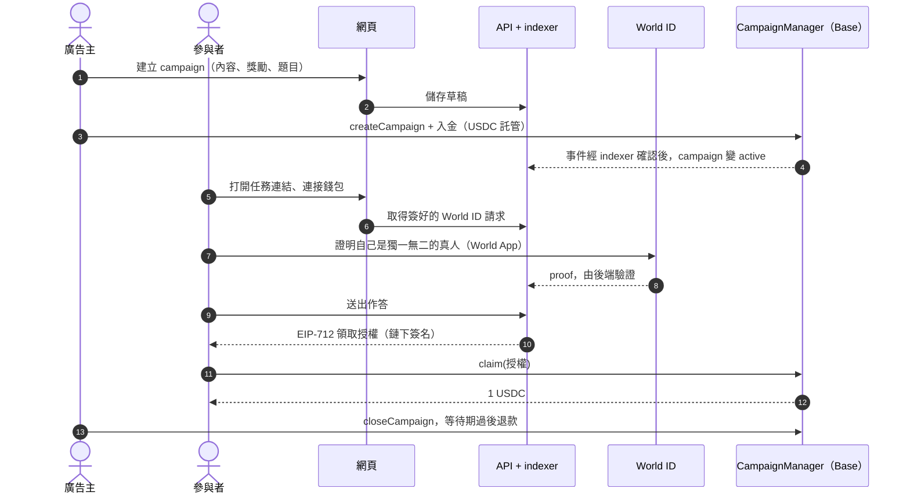
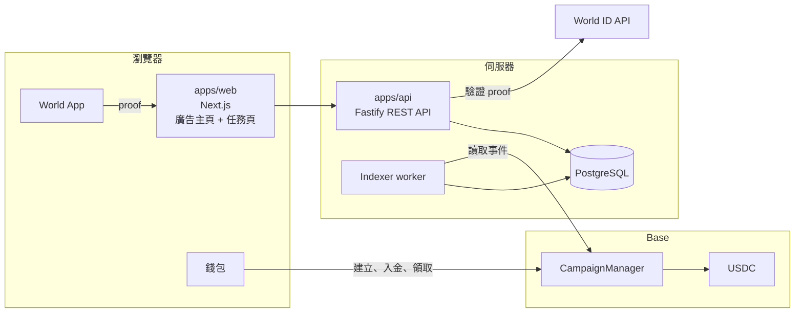

# Verified Human Attention Market

[English](README.md) | [繁體中文](README.zh-TW.md)

廣告主付費購買**經過驗證的獨立真人**的注意力，這些人以 **USDC** 領取報酬。預算鎖在鏈上託管合約，World ID 證明參與者是獨一無二的真人，鏈下驗證器判斷任務是否真的完成，合約才會發放獎勵。

> **這不是「看廣告賺幣」網站。** 目標是建立一個可驗證真人注意力的市場（之後提供 API），讓機器人和刷量農場無法掏空預算。

> ⚠️ **僅限測試網。** 合約尚未經過外部審計，也還沒通過 production 準備關卡（[#29](https://github.com/ChiJiun/verified-human-attention-market/issues/29)）。請勿使用真實資金。

**新的開發者或 AI session？** 請先讀 [AGENTS.md](AGENTS.md)。

---

## 目前進度

| | |
| --- | --- |
| **里程碑** | M1（概念驗證）已於 2026-10-14 在 **Base Sepolia** 跑通 |
| **證明了什麼** | 真實 World ID proof、作答驗證、後端簽發授權、鏈上發放 USDC，接著關閉與退款。[含交易紀錄的實測報告](docs/DEMO.md#base-sepolia-完整流程實測2026-10-1413) |
| **合約** | `CampaignManager` [`0x12cc9447CEb3f8E75dDf4463A1A4D9feB42bDFEc`](https://sepolia.basescan.org/address/0x12cc9447CEb3f8E75dDf4463A1A4D9feB42bDFEc)，Base Sepolia（chain `84532`） |
| **下一步** | 完成 M1 收尾，接著決定 [ADR-0010](https://github.com/ChiJiun/verified-human-attention-market/pull/61)：瀏覽即累積，登入與提領時驗證 World ID |

詳細進度：[docs/SDLC_STATUS.md](docs/SDLC_STATUS.md)。

---

## 運作方式



**誰負責判斷什麼**

| 問題 | 由誰判斷 | 為什麼放在這裡 |
| --- | --- | --- |
| 這是獨一無二的真人嗎？ | World ID（零知識證明） | 我們永遠不知道對方是誰，只拿到一個每個 campaign 專屬的識別值，用來擋第二次領取 |
| 對方真的有參與嗎？ | API（鏈下驗證器） | 規則常改，而且答案必須保密 |
| 這筆發放有效嗎？ | 合約 | 在鏈上檢查簽名、預算、名額上限、期限與重放 |
| 實際付了多少錢？ | **鏈** | 資料庫從已確認的鏈上事件對帳，永遠不反過來 |

**合約內建的安全規則**

- **預算守恆：** 發放加退款永遠不會超過入金金額。
- **防重放：** 每份授權有一次性的 nonce，每個錢包在同一個 campaign 只能領一次。
- **延後退款：** 要等到最後一份可能的授權都過期，廣告主才能退款，確保已經符合資格的參與者一定領得到。
- **曝險上限：** 每個 campaign 的獎勵、名額與預算在鏈上有上限（POC：1 USDC × 10）。

---

## 架構



| 套件 | 內容 |
| --- | --- |
| [`apps/web`](apps/web) | Next.js 前端：廣告主後台（`/advertiser`）與參與者任務頁（`/mission?campaign=…`，含 World ID widget） |
| [`apps/api`](apps/api) | 基於 PostgreSQL（Drizzle）的 Fastify API：campaign、SIWE 登入、World ID 驗證、作答、領取授權簽發、審核、分析。也負責鏈上事件 indexer 與對帳 worker |
| [`packages/contracts`](packages/contracts) | Solidity + Foundry：`CampaignManager` 託管合約，含單元、fuzz 與不變量測試，以及部署腳本與部署紀錄 |
| [`packages/shared`](packages/shared) | API 與前端共用的合約 ABI 與鏈設定 |

確切版本以各套件的 `package.json` 與 lockfile 為準。

---

## 在本機執行

本機 demo 使用本機鏈（anvil），搭配真的合約、API 與資料庫，只有 World ID 是模擬的。逐步說明：**[docs/DEMO.md](docs/DEMO.md)**。

需要：Node.js 24+、pnpm 12.4.2、Foundry v1.8.4（Windows 請裝在 WSL）、用 Docker 跑 PostgreSQL 16。

```bash
pnpm install
pnpm dev            # 前端 :3000，API :3001
```

每次 commit 前：

```bash
pnpm typecheck && pnpm test && pnpm lint && pnpm build && pnpm format:check
cd packages/contracts && forge fmt --check && forge build --sizes && forge test -vv
```

| 測試層級 | 指令 | 需要 |
| --- | --- | --- |
| 單元 + API（記憶體） | `pnpm test` | 無 |
| PostgreSQL 整合 | 設定 `TEST_DATABASE_URL` 後 `pnpm test` | PostgreSQL 16 |
| 合約 | 在 `packages/contracts` 執行 `forge test -vv` | Foundry |
| ABI 一致性 | 在 `packages/contracts` 執行 `forge build && node scripts/export-abi.mjs --check` | Foundry |
| 本機鏈端到端 | `pnpm --filter @vham/api test:e2e` | anvil + PostgreSQL |

CI 在每次 push 時執行 `javascript`、`e2e`、`solidity` 三個 job。本機設定請把 `.env.example` 複製成 `.env`，不要 commit 任何金鑰。部署到測試網：[docs/deployment/TESTNET.md](docs/deployment/TESTNET.md)。

---

## 文件導覽

| 文件 | 想知道什麼時讀它 |
| --- | --- |
| [AGENTS.md](AGENTS.md) | 在這個 repo 工作的規則、已完成什麼、下一步是什麼 |
| [docs/SDLC_STATUS.md](docs/SDLC_STATUS.md) | 專案現在進行到哪裡 |
| [docs/product/PRODUCT_BRIEF.md](docs/product/PRODUCT_BRIEF.md) | 產品為誰而做、為什麼要做 |
| [docs/product/REQUIREMENTS.md](docs/product/REQUIREMENTS.md) | MVP 必須做到什麼 |
| [docs/product/VISION.zh-TW.md](docs/product/VISION.zh-TW.md) | 長期願景、商業模式與完整路線圖（原本的 README） |
| [docs/architecture/MVP_ARCHITECTURE.md](docs/architecture/MVP_ARCHITECTURE.md) | 各元件怎麼組在一起 |
| [docs/architecture/CONTRACT_SPEC.md](docs/architecture/CONTRACT_SPEC.md) | 合約確切做什麼、保證什麼 |
| [docs/architecture/CLAIM_AUTHORIZATION.md](docs/architecture/CLAIM_AUTHORIZATION.md) | 簽名領取授權的運作方式 |
| [docs/architecture/API_SPEC.md](docs/architecture/API_SPEC.md) | 所有 API 端點與錯誤代碼 |
| [docs/architecture/DATA_MODEL.md](docs/architecture/DATA_MODEL.md) | 資料表與約束 |
| [docs/adr/](docs/adr/) | 每個重大決策的理由（見下表） |
| [docs/threat-model/THREAT_MODEL.md](docs/threat-model/THREAT_MODEL.md) | 可能出什麼問題、如何防範 |
| [docs/testing/TEST_PLAN.md](docs/testing/TEST_PLAN.md) | 測了什麼、怎麼測 |
| [docs/privacy/DATA_RETENTION.md](docs/privacy/DATA_RETENTION.md) | 保存哪些資料、保存多久、怎麼刪除 |
| [docs/operations/](docs/operations/) | 維運手冊、告警、事故處理、備份、審核、production 準備 |
| [docs/DEMO.md](docs/DEMO.md) | 如何跑完整流程，以及 Base Sepolia 實測紀錄 |
| [docs/deployment/TESTNET.md](docs/deployment/TESTNET.md) | 如何部署到 Base Sepolia |

### 架構決策紀錄（ADR）

| ADR | 決定 |
| --- | --- |
| [0001](docs/adr/0001-mvp-chain-base.md) | MVP 使用 Base；先做單鏈 |
| [0002](docs/adr/0002-first-use-case-sponsored-content.md) | 第一個任務：贊助內容 + 簡短理解測驗 |
| [0003](docs/adr/0003-poc-gas-ux.md) | POC 階段由使用者付測試網 gas；上真錢前要重新評估 |
| [0004](docs/adr/0004-claim-authorization-eip712.md) | 領取由鏈下 EIP-712 簽名授權、鏈上驗證 |
| [0005](docs/adr/0005-poc-campaign-economics.md) | POC 經濟參數：1 測試 USDC × 最多 10 次，0% 手續費 |
| [0006](docs/adr/0006-onchain-exposure-limits.md) | 曝險上限由合約強制執行 |
| [0007](docs/adr/0007-world-id-integration.md) | 透過 IDKit 接 World ID，每個 campaign 一個 action，不儲存原始身份資料 |
| [0008](docs/adr/0008-signer-custody-and-payout-limits.md) | 領取簽名金鑰的保管、管理權限與發放上限 |
| [0009](docs/adr/0009-quality-signals-and-reputation-scope.md) | 品質訊號只限單一 campaign，暫不做跨 campaign 信譽 |
| 0010 | *提議中：* 瀏覽即累積，登入與提領時驗證 World ID（[PR #61](https://github.com/ChiJiun/verified-human-attention-market/pull/61)） |

---

## 路線圖

| 里程碑 | 目標 | 狀態 |
| --- | --- | --- |
| M0 | 產品決策：第一個買家、鏈、gas、領取模型、經濟參數 | ✅ 完成 |
| **M1** | **POC：在測試網跑通完整的金流** | ✅ 已在 Base Sepolia 跑通；#12、#13、#19 最終審查中 |
| M2 | 給真實買家的 MVP：監控、隱私、審核、簽名金鑰保管 | 🟡 工程基礎已完成；尚無真實買家 |
| M3 | 封閉測試：品質訊號、公開 API、publisher SDK | 🟡 #25、#26 完成；#27 SDK 未開始 |
| M4 | AI agent 透過 x402 購買 campaign | ⬜ 未開始（#28） |
| M5 | 可放真錢的 production 準備：審計、值班 | 🟡 部分完成（#29） |
| M6–M7 | Publisher 網路、協議生態 | ⬜ 未開始 |
| M8 | 多鏈，只在有需求證據時才做 | ⬜ 延後（#30） |

含交付項目與完成標準的完整路線圖：[docs/product/VISION.zh-TW.md](docs/product/VISION.zh-TW.md#開發路線圖)。

---

## 名詞解釋

| 名詞 | 意思 |
| --- | --- |
| **ADR** | 架構決策紀錄（Architecture Decision Record）：一份短文件，說明一個決定、考慮過的其他方案與後果。狀態從 *Proposed（提議）→ Accepted（採納）* |
| **M0–M8** | 上方路線圖的里程碑 |
| **P0–P3** | issue 優先級：P0 必做且會擋住後續工作；P3 只在有需求證據時才做 |
| **EPIC** | 之後會拆成多個小 issue 的大型任務 |
| **World ID** | 證明「這是獨一無二的真人」的零知識證明，不會透露對方是誰 |
| **Nullifier** | World ID 在每個 app 與 action 下回傳的匿名值；同一個人永遠得到同一個值，所以能擋第二次領取 |
| **RP / RP 簽章** | Relying Party，也就是我們的 app。後端會為每個 World ID 請求簽名，防止別人冒充 |
| **IDKit** | World 的 SDK；widget 會顯示讓 World App 掃描的 QR code |
| **EIP-712** | 對結構化資料簽名的標準；後端簽出合約能驗證的領取授權 |
| **SIWE** | Sign-In with Ethereum：用錢包簽一則訊息來登入 |
| **Indexer** | 把已確認的合約事件讀進資料庫的 worker，會處理鏈重組（reorg） |
| **最小單位** | USDC 有 6 位小數，所以 `1000000` 代表 1 USDC。金額永遠不用浮點數儲存 |
| **Base Sepolia** | Base 的公開測試網（chain ID `84532`） |
| **anvil** | Foundry 的本機區塊鏈，用於開發與 CI |
