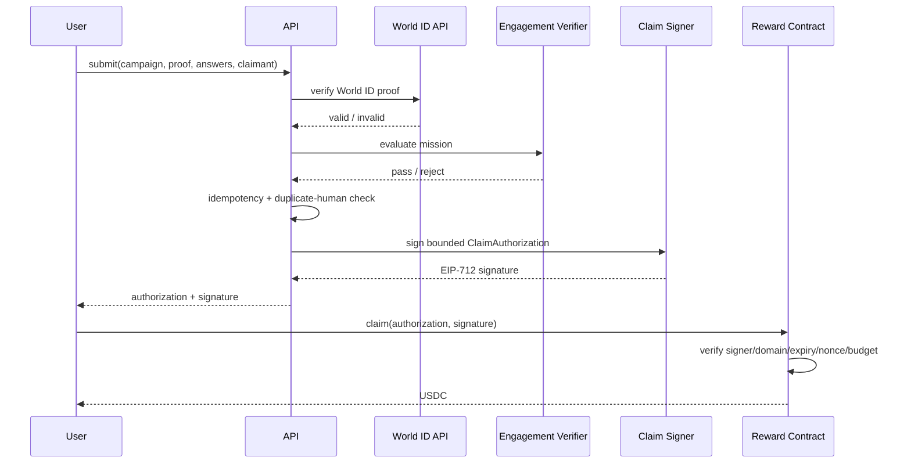

# Claim Authorization Design

> Status: System Design  
> Source decision: ADR-0004

## Purpose

Separate flexible off-chain engagement verification from deterministic on-chain payout.

The backend may decide whether a mission is valid, but it does **not** transfer user funds directly. It issues a bounded authorization that the reward contract verifies.

## Flow



## EIP-712 Type

```solidity
struct ClaimAuthorization {
    uint256 campaignId;
    bytes32 draftRef;
    address claimant;
    uint256 amount;
    bytes32 nonce;
    uint64 issuedAt;
    uint64 expiresAt;
}
```

Type string (typehash `0x190486b79e77ff5517da40fe874a526fb3507c8999e73a8a70f90d4e2e90005b`):

```text
ClaimAuthorization(uint256 campaignId,bytes32 draftRef,address claimant,uint256 amount,bytes32 nonce,uint64 issuedAt,uint64 expiresAt)
```

`draftRef` binds the authorization to the platform draft (ADR-0011): `claim`
reverts with `WrongDraft` unless `campaignIdByDraft[advertiser][draftRef] ==
campaignId`. After a reorg deeper than the confirmation depth the same id may
belong to another draft; an authorization for the old draft can then never be
paid from the new campaign's budget.

## Nonce

Nonce MUST be unique per authorization.

Recommended generation for backend-issued claims:

```
nonce = random 32-byte cryptographically secure value
```

Do not derive nonce solely from timestamp.

## Issuance and Expiry

POC maximum authorization lifetime: **15 minutes**.

The signed payload includes both `issuedAt` and `expiresAt`. The contract verifies:

- `issuedAt <= block.timestamp`;
- `expiresAt > block.timestamp`;
- `expiresAt > issuedAt`;
- `expiresAt - issuedAt <= MAX_AUTHORIZATION_TTL`;
- `issuedAt` is no later than the campaign's issuance deadline (manual `closedAt` or natural `endTime`).

This closes an important refund race: after the issuance deadline plus the maximum authorization TTL, every honestly issued authorization must have expired, so unused budget can be refunded without an on-chain reservation transaction for every authorization.

## Idempotency

The authorization is signed in the same request that accepts the completion
and returned with it (ADR-0011): the contract pays an authorization issued up
to `closedAt`, so a close after acceptance cannot strand the participant. If
no authorization can be issued there, nothing is recorded and the request
fails with the reason (`409` or `503`), so the same request can be sent again.
The response says `pending_authorization` only without a configured signer
(code `null`) and on a replay whose authorization cannot be reissued (with the
reason code). `POST .../authorization` can then be called again.

The accepted submission is the issuance identity. Its signed payload, nonce,
signature and EIP-712 domain are persisted atomically. A concurrent or repeated
authorization request returns the same active signature.

Before signing, the service reads **live** contract state via `eth_call`: the
current `authorizedSigner`, `campaignIdByDraft` and `campaigns(id)` (paid
completions, `closedAt`, `endTime`) and `claimedWallet(id, claimant)`. Indexed
events lag by the confirmation depth; these reads do not. RPC failures fail
closed. These reads, and the lookup of confirmed payouts in the index, run
before the transaction that records an acceptance opens, and the same
`campaigns(id)` reading decides whether the completion is accepted at all
(ADR-0011, decision 12). Inside the transaction only the campaign row lock,
the cap and payout-limit counts, the signature and the update run, so an
acceptance holds its pool connection for the database round trips plus at
most one signer call (bounded by the signer's timeout), never for an RPC.
The row lock is `FOR NO KEY UPDATE`, because every acceptance in flight already
holds `KEY SHARE` on the campaign row through its submission's foreign key and
`FOR UPDATE` would make concurrent acceptances deadlock.

- **Cap:** under the campaign row lock, a new authorization is issued only if
  `onchain paidCompletions + unexpired authorizations of other submissions <
  maxCompletions`. Every unexpired signature therefore stays redeemable, and
  late participants never receive a signature the contract would reject with
  `CompletionLimitReached`. An authorization whose `RewardClaimed` event is
  **confirmed** by the indexer is already part of `paidCompletions` and is
  not counted as outstanding again, so a paid slot is reusable at once
  instead of after the 15 minute TTL (otherwise, once more than half of a
  campaign's rewards were paid within one TTL, every further verified human
  would be refused until the earlier signatures expired). Payouts that are
  only observed (not yet confirmed) or not indexed yet are still counted
  twice, which errs on the safe side: an observed event can be reorged out
  while its signature remains redeemable.
- **Expiry:** an authorization that expired unredeemed is **reissued** with a
  new nonce and `issuedAt` (still subject to the cap and an active, open
  campaign). The contract pays each wallet once per campaign
  (`claimedWallet`), so reissuing cannot cause a second payout. If the wallet
  was already paid, the request returns `409 ALREADY_CLAIMED`.
- **Close:** issuance stops as soon as `closedAt != 0` on-chain, so no
  authorization is issued after the issuance deadline that the refund grace
  period relies on.
- **At acceptance:** a new accepted completion is signed inside the
  transaction that records it (`PostgresClaimRepository.within(tx)`); if no
  authorization can be issued the acceptance is rolled back, so an accepted
  completion without a redeemable authorization never exists (ADR-0011).
- **Binding:** the stored authorization records the on-chain campaign id,
  chain and contract it was signed for. It is replayed only while these equal
  the campaign's current link; after a deep-reorg relink or a redeploy it is
  unredeemable, is not counted as outstanding, and a new one is issued.

Submission endpoint accepts an `Idempotency-Key`.

Same key + same normalized request:

- returns the same submission result;
- MUST NOT create a second financial liability.

Same key + materially different request:

- reject with conflict.

## World ID Data

World ID proof verification and nullifier-related data remain off-chain.

Do not emit raw World ID nullifier data in public contract events.

## Revocation

POC has no per-authorization revocation list.

Risk is bounded by:

- short expiry;
- campaign pause;
- signer rotation;
- budget cap.

Production may add scoped revocation or signer epochs if required.
