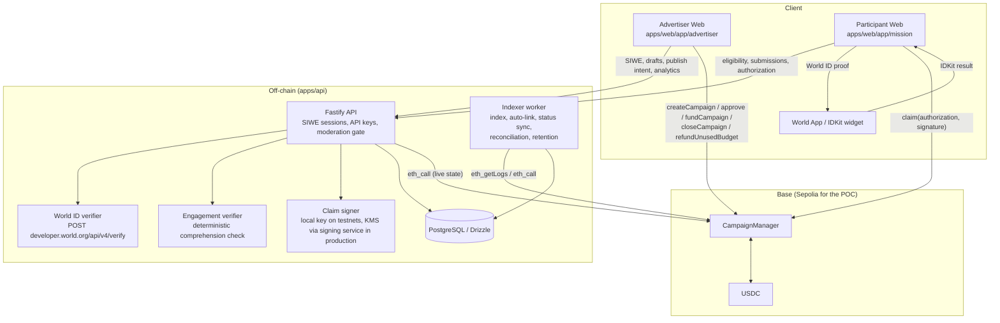
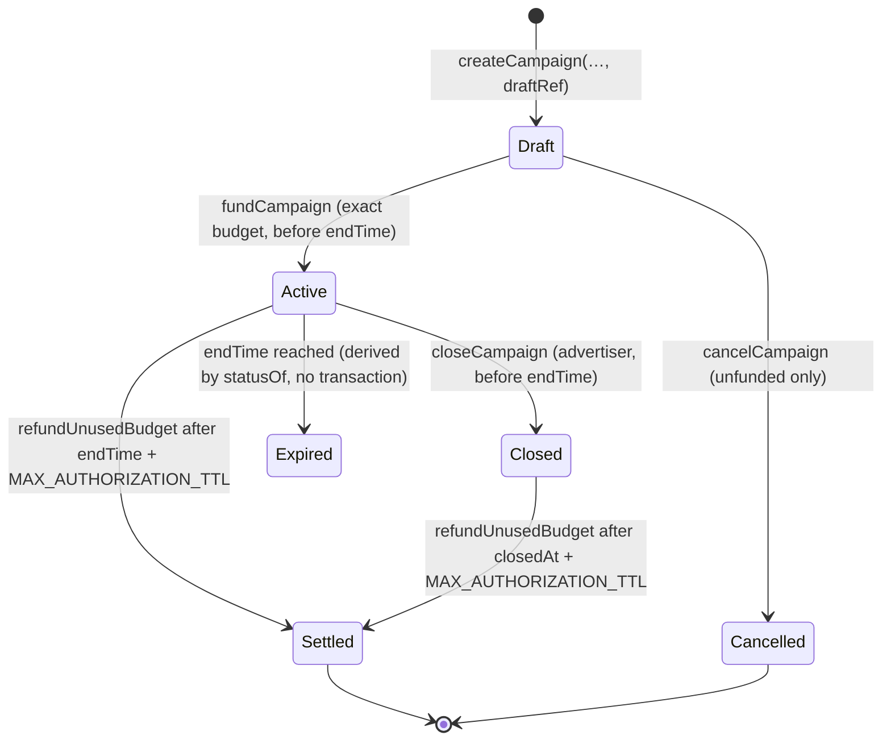

# MVP Architecture / MVP 技術架構

> Status: As built (reconciled with the code on 2026-10-19).
>
> Target: POC on Base Sepolia → MVP.
>
> Earlier versions of this page described a planned three-contract design (`CampaignFactory` / `CampaignEscrow` / `RewardDistributor`). The implementation uses a single `CampaignManager`; the page now documents what exists. Decisions live in `docs/adr/`.

## Architecture



Three processes share one database: the API (`apps/api/src/server.ts`), the indexer worker (`apps/api/src/indexer-worker.ts`, also runs retention and reconciliation on a timer) and one-off jobs (`retention-job.ts`, `reconcile-job.ts`, `reorg-recover.ts`). The web app talks to the API through a same-origin `/api/*` rewrite and to the chain through the user's injected wallet (viem; no wagmi).

## Stack (as built)

| Layer | Choice | Notes |
| --- | --- | --- |
| Web | Next.js 16 (App Router), React 19, TypeScript, `viem` 2.x, `@worldcoin/idkit` 4.4.0 | Two pages: advertiser and mission. No wallet library beyond viem's injected-provider transport. |
| API | Fastify 5, TypeScript (ESM), `zod`, `viem` | REST; see `docs/architecture/API_SPEC.md` and `API_CONTRACT.md` (error model, API keys, rate limits, versioning). |
| Persistence | PostgreSQL 16, Drizzle ORM + `drizzle-kit` migrations, `postgres` driver | Schema in `apps/api/src/db/schema.ts`; tables in `DATA_MODEL.md`. In-memory repositories exist for unit tests only. |
| Chain | `CampaignManager` (Solidity 0.8.30, Foundry 1.8.4), USDC | Single contract, no proxy, immutable exposure limits (ADR-0006). ABI exported to `@vham/shared` and checked in CI. |
| Identity | World ID (IDKit 4.4.0, RP-signed requests, v4 verify API) | One action per campaign; nothing but an HMAC participant key is stored (ADR-0007). |
| Signing | Local key (anvil / Base Sepolia) or `eth_signTypedData` signing service in front of a KMS key (production, ADR-0008) | EIP-712 `ClaimAuthorization` (ADR-0004, ADR-0011). |
| Ops | JSON logs with request ids, Prometheus metrics, alert rules, runbooks | `docs/operations/`. |

## Trust Boundary

### On-chain is authoritative for

- funded budget, paid rewards, refunds and the campaign's financial state (`campaigns(id)` and the `CampaignCreated / CampaignFunded / RewardClaimed / CampaignClosed / CampaignRefunded / CampaignCancelled` events);
- claim replay protection (`consumedNonces`, `claimedWallet`);
- which draft an on-chain campaign belongs to (`campaignIdByDraft[advertiser][draftRef]`, ADR-0011);
- exposure limits (immutable constructor parameters);
- pause and signer rotation.

There is **no protocol fee** in the POC contract (ADR-0005: 0%). A fee would be a contract change and a new ADR.

### Off-chain is authoritative for

- campaign drafts, missions (content URL, questions, answer key) and moderation state;
- World ID eligibility and the one-wallet-per-human-per-campaign binding;
- engagement evaluation (comprehension check) and the attempt cap;
- campaign-scoped quality flags and advertiser analytics (ADR-0009);
- issuing claim authorizations (within the on-chain caps);
- retention and erasure (`docs/privacy/DATA_RETENTION.md`).

The database mirrors on-chain lifecycle from **confirmed** events only; everything money-related is re-derived from events and cross-checked against the contract by `checkReconciliation`.

## Claim Model

Backend-signed EIP-712 authorization, verified on-chain (ADR-0004, amended by ADR-0011):

```text
ClaimAuthorization {
  uint256 campaignId;
  bytes32 draftRef;
  address claimant;
  uint256 amount;
  bytes32 nonce;
  uint64 issuedAt;
  uint64 expiresAt;
}
```

The contract checks, in `claim`:

1. the campaign is `Active` or `Closed`;
2. `claimant == msg.sender`;
3. `campaignIdByDraft[advertiser][draftRef] == campaignId` (`WrongDraft`);
4. `amount == rewardPerCompletion`;
5. `issuedAt <= block.timestamp < expiresAt`, `expiresAt - issuedAt <= MAX_AUTHORIZATION_TTL` (15 min);
6. `startTime <= issuedAt <= issuance deadline` (`closedAt`, else `endTime`);
7. the nonce is unused and the wallet was not paid for this campaign;
8. completions and budget remain;
9. the signature recovers to `authorizedSigner`;

then marks the nonce and wallet, updates accounting and transfers USDC.

Issuance rules (`docs/architecture/CLAIM_AUTHORIZATION.md`): live contract reads before signing; cap `paid + unexpired outstanding < maxCompletions` under the campaign row lock; reissue after expiry; signed inside the transaction that records an accepted completion, so an accepted completion without an authorization never exists; stored authorizations are bound to the on-chain id, chain and contract they were signed for.

## Campaign State Machine

On-chain (`CampaignManager.CampaignStatus`):



Claims are accepted while the status is `Active` or `Closed` and the authorization was issued before the issuance deadline, which is why the refund waits one authorization TTL after that deadline.

Database (`campaigns.status`): `draft` → `pending_onchain` (linked, unfunded) → `active` → `closed` / `settled` / `cancelled`, mirrored from confirmed events by `syncCampaignStatuses`. `expired` is a reserved value; the API enforces the time window from `startAt` / `endAt` and the live contract state instead of writing it. A campaign linked on another deployment is *retired* (ADR-0011) and refuses participation.

## Request Flow (first mission)

1. Advertiser signs in (SIWE), creates a draft with its mission; moderation starts `pending_review` outside anvil.
2. `POST /v1/campaigns/:id/publish` returns the transaction intent (`createCampaign` with `draftRef`, `approve`, `fundCampaign` with `draftRef`). The wallet sends them; the API links the draft from the receipt or by `campaignIdByDraft`, only once the creation is `INDEXER_CONFIRMATIONS` deep.
3. The indexer confirms `CampaignFunded` → status `active`.
4. Participant connects a wallet, obtains an RP-signed World ID request, proves personhood in World App; the API verifies the proof and binds the human to the wallet for this campaign.
5. Participant answers the comprehension questions. The API checks the campaign live on-chain (canonical creation, funded, open, within window, budget left), evaluates the answers, and — in one database transaction — records the acceptance and signs the authorization.
6. Participant sends `claim`; the indexer confirms `RewardClaimed`; analytics and reconciliation agree with the contract.
7. Advertiser closes (optional) and, after the grace period, refunds. The advertiser page offers **Close campaign** until one minute before `endTime`. It offers **Refund unused budget** once the block time passes the issuance deadline (`closedAt`, else `endTime`) plus `MAX_AUTHORIZATION_TTL` (15 min), unless the contract is paused. The page reads the campaign, the paused flag and the latest block time through the advertiser's wallet and simulates each transaction before asking for a signature. The contract still enforces both rules.

## Consistency and Failure Rules

| Situation | Rule | Where |
| --- | --- | --- |
| Backend says paid, chain says not paid | Chain wins; the database only mirrors confirmed events; `checkReconciliation` reports `INDEX_MISMATCH` / `UNBACKED_PAYOUT`. | `apps/api/src/reconciliation/check.ts` |
| Request retry | `Idempotency-Key` on campaign creation and submissions; same key + same request replays, different request conflicts; one accepted completion per human enforced by a partial unique index. | `DATA_MODEL.md`, `API_CONTRACT.md` |
| Lost RPC response after broadcasting `createCampaign` | Never resend blindly: link by `draftRef`; a duplicate creation reverts on-chain (`DraftAlreadyCreated`). | ADR-0011 |
| RPC failure during a decision | Fail closed: `503 CHAIN_UNAVAILABLE`; nothing is accepted or signed on guessed state. | claims / submissions services |
| World ID provider unavailable | `503`, no eligibility written. | `identity/world-id.ts` |
| Signer unavailable, cap or 24 h limit reached, campaign closed between check and signature | The acceptance transaction is rolled back and the request fails with the reason; the attempt is not consumed. | ADR-0011 decision 12 |
| Engagement verifier | Deterministic and in-process: a submission is `accepted` or `rejected` immediately; there is no pending state. | `missions/verifier.ts` |
| Shallow reorg (within `INDEXER_CONFIRMATIONS`) | Observed events are orphaned and never count as settlement; logs read across a reorg are never committed. | `chain/indexer.ts` |
| Reorg deeper than the confirmation depth | The deployment is halted (`indexer_halts`); API refuses participation and signing (`CHAIN_HALTED`); `reorg:recover` re-checks every link, then the worker rebuilds the index. | ADR-0011 decision 11 |
| Authorization signed for an id the draft no longer has | Not replayed and not counted; a new one is signed for the current id. | `claims/repository.ts` |
| Close before issued authorizations expire | Refund is only possible after the issuance deadline + TTL. | `CampaignManager.refundUnusedBudget` |

## Known Limitations (feasibility notes, 2026-10-19)

These do not block the testnet POC but must be revisited before real funds (#29):

- **Single signer, single API.** Issuance holds the campaign row lock while calling the signing service (5 s timeout). Fine at POC volume; horizontal scaling would need a per-campaign queue or shorter critical sections.
- **Indexer is one process** that scans every linked campaign on each pass (`syncCampaignStatuses`, `autoLinkCreatedCampaigns`). Linear in the number of campaigns; adequate for tens, not thousands.
- **User pays gas** (ADR-0003): participants on Base Sepolia need test ETH; consumer UX needs sponsorship before the real-money MVP.
- **One RPC endpoint** per process; the public Base Sepolia RPC limits `eth_getLogs` to 200 blocks. A second provider is a deployment task.
- **Browser sessions** (SIWE, #72): the token is an `HttpOnly; Secure; SameSite=Strict` host cookie with Fetch Metadata / `Origin` CSRF checks, and the web app ships a nonce-based CSP. An XSS that gets past the CSP can still act as the advertiser while the page is open, but cannot read the token (Threat Model T-015).
- **Deep-reorg recovery is manual** by design; Base is an L2 with a centralized sequencer, so this is expected to be rare.
- **Close and refund buttons appear only for campaigns on the current deployment.** A campaign on an earlier deployment, such as the pre-ADR-0011 contract, is retired and gets no buttons, so its advertiser still uses `cast` for both transactions.
- **Base mainnet is deliberately not configurable** until the production-readiness gate passes.

## Deferred Architecture

Not in the critical path (AGENTS.md §6):

- x402 agent payments (#28; research draft in PR #66 is not a decision);
- AARC / multi-chain (#30);
- publisher SDK and attribution (#27);
- cross-campaign reputation (ADR-0009 requires a new ADR);
- ML fraud engine;
- alternative settlement rails (e.g. non-EVM, feeless currencies): incompatible with the escrow + EIP-712 claim model and with "chain is authoritative for settlement"; would need a new ADR and a separate contract design.

These should be integrated after the economic loop is validated on Base Sepolia with a real World ID proof (#12, #13).
